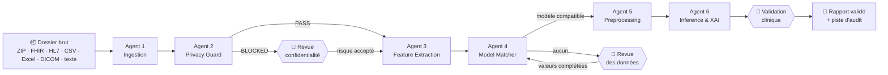

# ICSMAI 2027 · Training School — Pipeline multi-agents médical de bout en bout

[](https://colab.research.google.com/github/omsefraoui/icsmai27-medagents/blob/main/notebooks/00_installation_ollama.ipynb)

**Du fichier brut à l'explicabilité clinique** — atelier pratique de 4 h.

Six agents orchestrés par **LangGraph**, un LLM **100 % local** (Ollama), des contrats de données **Pydantic v2**,
des modèles **scikit-learn** expliqués par **SHAP**, et un **humain dans la boucle**.

> ⚠️ **Usage pédagogique uniquement.** Patients, cohortes et modèles sont **synthétiques**. Aucun résultat n'a de
> validité clinique.



## Les six agents

| Agent | Déterministe (code) | LLM local (contraint + vérifié) |
|---|---|---|
| 1 · Ingestion | octets magiques, parsing, validation de schéma, ZIP sécurisé | qualification des textes libres |
| 2 · Privacy Guard | identifiants connus, regex, pseudonymisation HMAC, décalage de dates, DICOM PS3.15, contrôle résiduel | NER des PHI résiduelles (rejet si absente du texte) |
| 3 · Feature Extraction | FHIR/HL7/CSV → LOINC, SNOMED-CT, CIM-10, ATC ; unités ; fusion et conflits | extraction depuis le texte **avec citation vérifiée** ; libellés inconnus → **liste fermée** |
| 4 · Model Matcher | inclusion/exclusion, couverture, domaine, fraîcheur, score de confiance | choix **parmi les modèles compatibles** + justification |
| 5 · Preprocessing | plan issu de la carte du modèle, implémentation de référence | écriture du code → AST + bac à sable + contrat + **test différentiel** |
| 6 · Inference & XAI | prédiction, incertitude bootstrap, SHAP, chiffres du rapport | rédaction de la prose → **vérification d'ancrage** des nombres |

## Contenu du dépôt

```
medagents/                 package Python
  agents/                  les 6 agents (+ base.py : audit)
  tools/                   parsers, phi, terminology, sandbox, explain, clinical
  model_registry/          cartes de modèles, simulation des cohortes, entraînement, registre vérifié (SHA-256)
  graph.py                 orchestration LangGraph + interruptions Human-in-the-Loop
  evaluation.py            métriques contre la vérité terrain
  datagen.py               génération des dossiers patients synthétiques
notebooks/                 00 (installation) puis 01-04 (un par module), version participant avec TODO
notebooks/solutions/       versions corrigées
data/raw/                  dossier_P001.zip, dossier_P002.zip, dossier_P003.zip
data/ground_truth/         PHI et features attendues (évaluation)
scripts/                   colab_ollama.sh, build_notebooks.py (source unique des notebooks)
tests/                     tests pytest et exécution des notebooks avec un LLM simulé (CI sans GPU)
```

## Démarrage rapide

**Option A — portable (Python 3.10+, 3.12 recommandé, 16 Go de RAM)**
```bash
# 1. Installer Ollama : https://ollama.com/download   puis :
ollama pull llama3.1:8b          # ≈ 4,9 Go — ou llama3.2:3b (≈ 2 Go) sur une machine modeste
# 2. Projet
git clone https://github.com/omsefraoui/icsmai27-medagents.git && cd icsmai27-medagents
python -m venv .venv && source .venv/bin/activate      # Windows : .venv\Scripts\activate
pip install -r requirements.txt
jupyter lab notebooks/00_installation_ollama.ipynb
```

**Option B — Google Colab** : ouvrir un notebook, *Exécution › Modifier le type d'exécution › GPU T4*, exécuter la
cellule 0 (clone, dépendances, installation et démarrage d'Ollama, téléchargement du modèle).

**Option C — serveur Ollama partagé** : `export OLLAMA_HOST=http://<ip-du-serveur>:11434` (ou dans la cellule 0).

Variables utiles : `MEDAGENTS_MODEL` (modèle Ollama), `OLLAMA_HOST`, `MEDAGENTS_OUTPUT_DIR`, `MEDAGENTS_SECRET`
(secret de pseudonymisation — à placer dans un coffre en production).

## Pour le formateur

1. Dépôt : https://github.com/omsefraoui/icsmai27-medagents (déjà renseigné dans `scripts/nb/common.py` ; après toute
   modification des notebooks, régénérer avec `python scripts/build_notebooks.py`).
2. **Serveur de secours** : une machine avec GPU (≥ 8 Go de VRAM) qui sert `llama3.1:8b` sur le réseau de la salle
   (`OLLAMA_HOST=0.0.0.0 ollama serve`), pour les participants sans GPU ni Colab.
3. **Répétition générale** obligatoire sur le matériel réel : exécuter `notebooks/solutions/*` avec le modèle prévu et
   chronométrer (temps d'appel LLM ≈ 5-30 s selon le matériel).
4. Tests sans GPU : `python -m pytest -q tests` et `bash tests/run_notebooks_fake.sh` (LLM **simulé**, uniquement pour
   vérifier la mécanique — les comportements du vrai LLM sont à valider en répétition).

## Licence et avertissement
Code fourni à des fins de formation. Données fictives : toute ressemblance avec des personnes réelles serait fortuite.
Ne pas utiliser pour des décisions cliniques.
